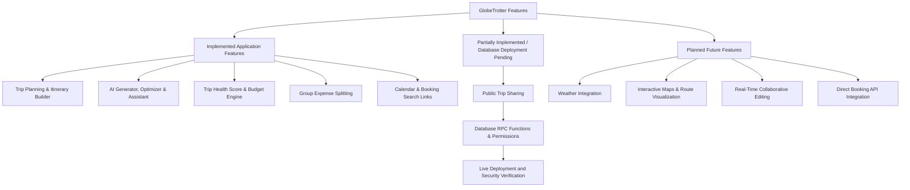

# GlobeTrotter — Current Project Specification & Development Guide

## 1. Project Overview & Problem Statement

- **Project Name:** GlobeTrotter
- **Problem Statement:** PS-1 — Empowering Personalized Travel Planning
- **Repository:** [GitHub Repository](https://github.com/rehanpatwegar/travel-planner)
- **Live Application:** [GlobeTrotter](https://travel-planner-virid-pi.vercel.app/)
- **Status:** Core application features implemented; database security remediation and live deployment state require independent verification.

### Purpose & Vision

Modern travel planning often forces travelers to juggle disconnected spreadsheets, map pins, booking receipts, messaging threads, and notes.

GlobeTrotter is a full-stack, responsive travel-planning platform that centralizes multi-destination route management, day-by-day scheduling, expense tracking, calendar timelines, group financial settlement, and AI-assisted recommendations into a unified workspace.

The application is designed as a travel-planning workspace rather than merely a marketing landing page or a standalone chatbot.

---

## 2. Main User Journey

**Sign Up / Login → Create Trip → Add Cities & Stops → Plan Activities → Inspect Health & Budget → Split Expenses → Share Trip**

1. **Authentication:** Users register and sign in with email and password using Supabase Auth and server-side cookie session handling.
2. **Dashboard & Route Sequencing:** Users manage their trips, create multi-city travel plans, define arrival and departure windows, and add destinations from the curated catalog or as custom stops.
3. **Day-by-Day Scheduling:** Activities are assigned to specific days, time windows, and spending categories, with drag-and-drop reordering.
4. **AI Planning & Optimization:** Travelers can generate itinerary drafts using Google Gemini or a local heuristic fallback, optimize existing schedules, and consult an in-trip assistant.
5. **Diagnostics & Financial Management:** Travelers evaluate itinerary balance using a 0–100 Trip Health Score, categorize spending into five pillars, review price-confidence tiers, and simplify group debts.
6. **Sharing & Booking:** Travelers can configure share links and access pre-populated booking search links to external travel platforms.

---

## 3. Feature Implementation Status

Features are grouped according to their application implementation and database deployment dependencies.



### 3.1 Implemented Application Features

The following features are represented in the application codebase. Their live production behavior should be confirmed through application testing.

- **Authentication & Profiles:** Sign-up, login, forgot-password, password reset, and profile management using `@supabase/ssr` and the PKCE authentication flow.
- **Multi-City Trip Management:** Chronological route planning, multi-currency support (`USD`, `EUR`, `GBP`, `JPY`, `CAD`, `AUD`, `CHF`, `INR`), trip management, and deletion workflows.
- **Curated Destination & Activity Discovery:** City search and activity discovery by category, duration, and price, using a curated read-only catalog.
- **Day-by-Day Itinerary Builder:** Drag-and-drop activity sequencing using `@dnd-kit/core` and `@dnd-kit/sortable`, time-conflict detection, and day-wise cost subtotals.
- **Interactive Calendar Timeline:** Calendar views powered by `@fullcalendar/react`.
- **Trip Health Score Engine:** Deterministic 0–100 scoring across five dimensions (`lib/scoring/tripHealth.ts`).
- **Budget & Price Confidence Engine:** Five spending pillars, four price-confidence tiers, cost-saving recommendations, and Recharts financial visualizations (`lib/budget/budgetEngine.ts`).
- **Group Expense Splitting:** Companion management, cent-exact equal splits, custom splits, and net-balance debt simplification (`lib/budget/groupSplitEngine.ts`).
- **Booking Search Links:** Pre-populated search-link generators for Booking.com, Google Flights, Trainline, IRCTC, Kayak, and GetYourGuide (`lib/booking/links.ts`).
- **AI Trip Generator:** Structured itinerary generation through the Google Gemini REST API, with a local heuristic fallback (`lib/ai/generator.ts`).
- **AI Itinerary Optimizer:** Schedule pacing and geographic clustering analysis, with an interactive review before applying changes (`lib/ai/optimizer.ts`).
- **Conversational Trip Assistant:** Context-aware travel assistant with server-side intent classification (`lib/ai/assistant.ts`).
- **AI API Rate Limiting:** In-memory sliding-window rate limiting (`lib/security/rateLimit.ts`). This is best-effort and operates per application instance.
- **Automated Verification Scripts:** Eight verification scripts are listed under `scripts/`. Exact assertion counts and successful execution should be confirmed by running the current test commands.

### 3.2 Partially Implemented / Database-Dependent Features

**Sanitized Public Trip Sharing**

Relevant files:
- `app/share/[slug]/page.tsx`
- `lib/sharing/publicShare.ts`

The application-side implementation includes:
- Cryptographically generated share slugs.
- Share-link configuration.
- Copy-permission settings.
- Expiration timestamps.
- Client-side RPC calls to `get_public_shared_trip(p_slug)` and `increment_shared_trip_view(p_slug)`.
- Public serialization intended to omit private organizer information, including user IDs, private notes, and budget totals.

**Database deployment status:** The required RPC functions and related database security changes are documented in `db/proposals/20261031_security_remediation_proposal.sql`. They have not been confirmed as deployed to the live Supabase database.

Therefore, successful anonymous public sharing in production must not be assumed until the required database functions, permissions, and policies have been deployed and tested.

### 3.3 Planned Features

- Real-time weather integration and climate-adjusted activity recommendations.
- Interactive map-based route visualization with transit overlays.
- Real-time collaborative editing using Supabase Realtime or WebSockets.
- Direct booking API integration and instant inventory reservations.
- Optional administrative moderation dashboard.

---

## 4. Deep Dive: Core Feature Systems

### 4.1 Trip Health Score Engine

**File:** `lib/scoring/tripHealth.ts`

A deterministic TypeScript diagnostic engine evaluates itinerary feasibility on a 0–100 scale across five dimensions.

| Dimension | Maximum Points | Evaluation Criteria |
|---|---:|---|
| Budget Fit | 20 | Compares planned spending and logged expenses against the declared budget. Includes deductions for budget overruns. |
| Schedule Conflicts | 25 | Evaluates overlapping activity time windows on the same day. |
| Daily Workload | 20 | Evaluates activity density and empty travel days. |
| Rest Time | 20 | Checks transition buffers between consecutive timed activities. |
| Travel Feasibility | 15 | Evaluates stop chronology and long-distance transfers scheduled alongside heavy workloads. |
| **Total** | **100** | **Overall itinerary health score.** |

**Qualitative Ratings**

- Excellent: 90–100
- Good: 75–89
- Needs Attention: 55–74
- Critical Issues: Below 55

**Implementation safeguard:** The engine includes logic intended to prevent double-counting linked planned-item estimates and actual logged expenses.

### 4.2 Budget & Price Confidence Engine

**File:** `lib/budget/budgetEngine.ts`

**Five spending pillars:**

1. Accommodation
2. Transport
3. Food & Dining
4. Activities
5. Other

**Four price-confidence tiers:**

1. **Verified Booking:** A confirmed logged transaction or booking receipt.
2. **AI Estimate:** A planned activity cost estimated through the AI workflow.
3. **Heuristic Benchmark:** A regional baseline or city benchmark.
4. **Unverified:** A manually entered estimate without independent verification.

**Cost-saving diagnostics:** The engine identifies potentially expensive activities using cost thresholds and category comparisons, then presents substitution suggestions.

**Analytics:** Recharts is used for financial category and spending visualizations.

### 4.3 Group Expense Splitting & Debt Simplification

**File:** `lib/budget/groupSplitEngine.ts`

- **Cent-Exact Equal Splitting:** Divides expenses evenly and distributes rounding remainders across participants. For example, $100 divided among three people becomes $33.34, $33.33, and $33.33.
- **Custom Splits:** Supports explicit participant amounts with validation against the total expense.
- **Debt Simplification:** Calculates net balances using `Net Balance = Amount Paid - Amount Owed` and applies a greedy settlement algorithm to reduce the number of bilateral transactions.
- **Relational Integrity Guards:** Application-level checks validate that payers and participants belong to the relevant trip. Member deletion is restricted when active expenses or splits depend on that member.

### 4.4 AI Travel Intelligence Suite

**Directory:** `lib/ai/`

**Google Gemini REST API**

The application uses native HTTPS requests to communicate with Google's Gemini API, with an API key supplied through a server-side environment variable.

The model configuration is controlled through `GEMINI_MODEL`, with a default and fallback model defined by the application implementation.

**Thinking Budget**

Where supported by the selected model, the application configures a thinking budget to reduce unnecessary reasoning overhead for structured generation calls. This does not eliminate network transit time or normal inference latency.

**Heuristic Fallbacks**

The generator and optimizer include local heuristic fallback paths intended to keep selected planning functionality available when external AI access is unavailable or unconfigured.

**AI Trip Generator**

`components/ai/AITripGeneratorWizard.tsx`

A multi-step wizard collects destination information, dates, budget constraints, travel style, and pacing preferences to produce a structured itinerary draft.

**AI Itinerary Optimizer**

`components/ai/ItineraryOptimizerModal.tsx`

Analyzes scheduling and geographic organization, then presents proposed changes for review before application.

**Conversational Trip Assistant**

`components/ai/TripAssistantDrawer.tsx`

Provides a conversational interface grounded in active trip information. Server-side intent classification is used to restrict unsupported queries.

**Rate Limiting**

`lib/security/rateLimit.ts`

The application uses an in-memory sliding-window rate limiter. In serverless and multi-instance environments, each instance maintains its own state. It should therefore be treated as best-effort protection, not globally synchronized rate limiting.

### 4.5 Booking Search Links

**File:** `lib/booking/links.ts`

The application generates pre-populated search links for external travel platforms.

- **Hotels:** Booking.com search links.
- **Flights:** Google Flights search links.
- **Trains:** Trainline for European routes and IRCTC for Indian rail journeys.
- **Car Rentals:** Kayak search links.
- **Activities:** GetYourGuide destination search links.

**Important disclaimer:** GlobeTrotter acts as a travel-planning and search-link platform. These links do not guarantee live ticket inventory, booking confirmation, seat availability, or current prices. Users complete reservations on the respective external platforms.

---

## 5. Technology Stack & Dependencies

The following table describes the project's technology choices. Exact installed versions should be checked against `package.json` and the lockfile.

| Layer | Technologies | Purpose |
|---|---|---|
| Framework | Next.js App Router | Server Components, Route Handlers, and application routing |
| Language & Runtime | TypeScript, Node.js | Type-safe application development |
| UI Library | React | Component-based user interface |
| Styling | Tailwind CSS | Responsive utility-first styling |
| Component Primitives | shadcn/ui, Radix UI | Accessible dialogs, dropdowns, and inputs |
| Icons | Lucide React | Application iconography |
| Database & Auth | Supabase, PostgreSQL, `@supabase/ssr`, `@supabase/supabase-js` | Database access and authentication |
| AI Integration | Google Gemini REST API | Structured itinerary generation and AI assistance |
| Calendar | FullCalendar | Interactive calendar and activity scheduling |
| Drag & Drop | dnd-kit | Activity reordering |
| Charts | Recharts | Budget and spending visualizations |
| Deployment | Vercel | Application hosting |

---

## 6. Project Directory & Route Structure

The following is the intended high-level project structure. Verify it against the current repository before using it as an exhaustive file inventory.

```text
travel-planner/
├── app/
│   ├── (app)/
│   │   ├── dashboard/page.tsx
│   │   ├── profile/page.tsx
│   │   ├── search/
│   │   │   ├── activities/page.tsx
│   │   │   └── cities/page.tsx
│   │   └── trips/
│   │       ├── page.tsx
│   │       ├── new/page.tsx
│   │       └── [id]/
│   │           ├── budget/page.tsx
│   │           ├── builder/page.tsx
│   │           ├── calendar/page.tsx
│   │           └── view/page.tsx
│   ├── (auth)/
│   │   ├── forgot-password/page.tsx
│   │   ├── login/page.tsx
│   │   ├── reset-password/page.tsx
│   │   └── signup/page.tsx
│   ├── api/
│   │   ├── activities/route.ts
│   │   ├── ai/
│   │   │   ├── assistant/route.ts
│   │   │   ├── chat/route.ts
│   │   │   ├── generate/route.ts
│   │   │   ├── optimize/route.ts
│   │   │   ├── optimize/apply/route.ts
│   │   │   └── save/route.ts
│   │   ├── auth/
│   │   │   ├── callback/route.ts
│   │   │   └── signout/route.ts
│   │   ├── cities/route.ts
│   │   └── trips/[id]/
│   │       ├── route.ts
│   │       ├── expenses/
│   │       │   ├── route.ts
│   │       │   └── [expenseId]/route.ts
│   │       ├── items/
│   │       │   ├── route.ts
│   │       │   └── [itemId]/route.ts
│   │       ├── members/
│   │       │   ├── route.ts
│   │       │   └── [memberId]/route.ts
│   │       ├── share/route.ts
│   │       └── stops/route.ts
│   ├── share/[slug]/page.tsx
│   ├── globals.css
│   ├── layout.tsx
│   └── page.tsx
├── components/
│   ├── ai/
│   │   ├── AITripGeneratorWizard.tsx
│   │   ├── ItineraryOptimizerModal.tsx
│   │   └── TripAssistantDrawer.tsx
│   ├── trip/
│   │   ├── ActivitySearchModal.tsx
│   │   ├── AddStopModal.tsx
│   │   ├── BookTripSection.tsx
│   │   ├── CostSavingModal.tsx
│   │   ├── DroppableDayColumn.tsx
│   │   ├── GroupSplitBalancesCard.tsx
│   │   ├── PriceConfidenceBadge.tsx
│   │   ├── ShareTripModal.tsx
│   │   ├── SortableItineraryItem.tsx
│   │   ├── TripBudgetClient.tsx
│   │   ├── TripBuilderWorkspace.tsx
│   │   ├── TripCalendarClient.tsx
│   │   ├── TripHealthBadge.tsx
│   │   ├── TripHealthModal.tsx
│   │   └── TripMembersCard.tsx
│   └── ui/
├── db/
│   ├── archive/
│   │   └── 20261021_allow_catalog_insert.sql
│   ├── migrations/
│   │   ├── 20261022_group_trip_split.sql
│   │   └── 20261022_group_trip_split_rls_authenticated.sql
│   ├── proposals/
│   │   ├── 20261029_fix_trip_visibility_rls.sql
│   │   ├── 20261031_security_remediation_proposal.sql
│   │   └── rpc_delete_trip.sql
│   ├── schema.sql
│   └── seed.sql
├── lib/
│   ├── ai/
│   ├── booking/
│   ├── budget/
│   ├── scoring/
│   ├── security/
│   ├── sharing/
│   ├── supabase/
│   └── utils.ts
├── proxy.ts
├── scripts/
├── .env.example
├── LICENSE
├── next.config.mjs
└── package.json
```

---

## 7. Database Architecture, Schemas & Migrations

The repository describes the following ten core application tables across `db/schema.sql` and the group-splitting migration files.

### 7.1 Database Table Inventory

1. `profiles`: User profile data, with profile creation associated with the authentication workflow.
2. `cities`: Curated destination catalog.
3. `activities`: Curated attractions and benchmark activities associated with cities.
4. `trips`: User travel plans.
5. `trip_stops`: Chronological destination stops within a trip.
6. `itinerary_items`: Day-by-day scheduled activities with time slots, categories, and estimates.
7. `expenses`: Budget transactions and actual spending.
8. `shared_trips`: Public sharing configuration, slugs, and expiration settings.
9. `trip_members`: Group travel companions.
10. `expense_splits`: Expense allocation records for group participants.

**Note:** This is the repository's documented schema inventory. It is not proof that every table or policy currently exists in the live Supabase database.

### 7.2 Database Execution Guidelines

Before applying any SQL, inspect the existing live database schema and migration state.

The repository contains:

- `db/schema.sql`: Base schema definition.
- `db/seed.sql`: Curated destination and activity seed data.
- `db/migrations/`: Incremental feature migrations.
- `db/proposals/`: Proposed database changes that require review.
- `db/archive/`: Retired scripts that must not be applied.

Do not automatically rerun migrations simply because they exist in the repository. Check table, constraint, index, trigger, and policy existence first.

> [!IMPORTANT]
> **Pre-Migration Verification**
>
> Before applying a migration to a running Supabase database, verify the current schema state and the existence of relevant tables and constraints. Never apply migrations blindly or execute SQL automatically as part of application builds or client workflows.

> [!CAUTION]
> **Database Security & Deployment**
>
> - **Repository Specification vs. Live Security:** RLS declarations in `db/schema.sql` and migration files describe intended database protections. They do not independently prove that the live database is secure.
> - **Live Cluster Verification:** Effective security depends on active PostgreSQL policies, role grants, default privileges, and table ACLs. These must be independently inspected against the live database.
> - **Security Proposals:** Files in `db/proposals/`, including `20261031_security_remediation_proposal.sql`, `20261029_fix_trip_visibility_rls.sql`, and `rpc_delete_trip.sql`, are proposals and must not be treated as deployed migrations.
> - **Archived Scripts:** `db/archive/20261021_allow_catalog_insert.sql` is retired. Do not apply it.

---

## 8. Environment Variables & Configuration

Configure the application using `.env.local`, based on `.env.example`.

| Variable | Requirement | Exposure | Description |
|---|---|---|---|
| `NEXT_PUBLIC_SUPABASE_URL` | Required | Client & Server | Supabase project HTTPS endpoint. |
| `NEXT_PUBLIC_SUPABASE_ANON_KEY` | Required | Client & Server | Public Supabase key intended for browser use, subject to correct database security configuration. |
| `GEMINI_API_KEY` | Optional for fallback-capable workflows | Server Only | Enables Google Gemini API functionality. AI-backed functionality requires a valid key; applicable heuristic fallbacks may operate without it. |
| `GEMINI_MODEL` | Optional | Server Only | Overrides the configured default Gemini model. |
| `SUPABASE_SERVICE_ROLE_KEY` | Only if required by a specific administrative backend workflow | Server Only | Privileged key. Never expose it to browser-accessible code or public repositories. |

Never commit `.env.local` or expose API secrets in client-side code.

---

## 9. Security & Privacy Architecture

### Application-Level vs. Database-Tier Security

- **Application Controls:** Next.js API Route Handlers are intended to authenticate requests using Supabase Auth sessions and enforce trip ownership before permitting protected operations.
- **Repository-Declared RLS:** PostgreSQL RLS policies are described in `db/schema.sql` and migration scripts for application data tables.
- **Live Database State:** Active Supabase policies, role grants, and table ACL permissions must be independently verified. Repository declarations alone are not sufficient evidence of live database isolation.
- **Pending Remediation:** Files in `db/proposals/` document proposed changes. They should be reviewed, deployed through a supervised process, and verified before security claims are upgraded.

### Secrets Isolation

- `.env.local` should remain Git-ignored.
- `GEMINI_API_KEY` must only be accessed by server-side application code.
- Privileged Supabase credentials must never be exposed to client bundles.

### Prompt Injection & Abuse Mitigation

- **Best-Effort Rate Limiting:** `lib/security/rateLimit.ts` provides in-memory request throttling. Its state is local to each application instance and is not a globally synchronized limit.
- **Intent Guardrails:** `lib/ai/assistant.ts` contains server-side intent classification intended to filter unsupported requests before dispatching AI calls.

### Financial & Identity Privacy in Sharing

`lib/sharing/publicShare.ts` contains public-share serialization logic intended to exclude sensitive organizer fields, such as user IDs, private notes, and total budget information.

The actual privacy guarantees of public sharing depend on the deployed RPC functions, database permissions, and the live implementation.

### Relational Integrity Guards

The group-expense application logic includes checks intended to:
- Prevent deleting companions who are referenced by active expenses or splits.
- Validate that payers and split participants belong to the relevant trip.

These application-level checks should be complemented by appropriate database constraints and RLS policies.

---

## 10. Historical 12-Part Implementation Plan

The original implementation plan serves as a development history and completion record. It is not an instruction to rebuild the application.

| Part | Milestone | Documented Status |
|---|---|---|
| Part 1 | Project Setup, Next.js App Router, Tailwind CSS, shadcn/ui, Supabase Client & Landing Page | Completed |
| Part 2 | Database Schema and Seed Data | Implemented in repository |
| Part 3 | Authentication and Profiles | Implemented |
| Part 4 | Dashboard, Trip Creation & My Trips | Implemented |
| Part 5 | City & Activity Catalog Search | Implemented |
| Part 6 | Itinerary Builder & Drag-and-Drop | Implemented |
| Part 7 | Itinerary View & Calendar | Implemented |
| Part 8 | Budget Analytics & Expense Logging | Implemented |
| Part 9 | Public Sharing & User Profile Management | Partially complete; live sharing database dependencies pending verification |
| Additional Milestone | Group Expense Splitting & Debt Simplification | Application implementation and migration files present; live migration state must be verified |
| Part 10 | AI Trip Generator & Persistence | Implemented |
| Part 11 | AI Optimizer & Conversational Assistant | Implemented |
| Part 12 | Quality Verification, Polish & Documentation | Verification scripts and documentation present; current results must be confirmed by execution |

---

## 11. Development, Quality Checks & Testing Guide

### 11.1 Local Setup Commands

```bash
# 1. Clone repository
git clone https://github.com/rehanpatwegar/travel-planner.git
cd travel-planner

# 2. Install dependencies
npm install

# 3. Configure environment
# Windows PowerShell:
Copy-Item .env.example .env.local

# macOS / Linux:
cp .env.example .env.local

# 4. Start local development server
npm run dev
```

### 11.2 Quality Verification Commands

Run the commands supported by the current `package.json` before proposing or releasing changes.

```bash
# Run configured test suite, if available
npm test

# Run lint checks
npm run lint

# Run TypeScript verification
npx tsc --noEmit

# Run production build
npm run build
```

A successful local build does not independently verify live database permissions, external API availability, or production deployment behavior.

### 11.3 Verification Script Inventory

The repository documentation lists the following verification scripts:

- `scripts/verify-trip-health.mjs`: Trip Health Score boundary and scoring cases.
- `scripts/verify-budget-engine.mjs`: Spending pillars, confidence tiers, and cost diagnostics.
- `scripts/verify-group-split-engine.mjs`: Cent-exact splitting and debt settlement logic.
- `scripts/verify-booking-links.mjs`: External booking search-link construction.
- `scripts/verify-targeted-fixes.mjs`: Targeted utility, currency, and assistant guardrail checks.
- `scripts/verify-cross-account-trip-isolation.mjs`: Application-level ownership and cross-account isolation checks.
- `scripts/verify-group-split-api.mjs`: Group expense API and participant validation checks.
- `scripts/verify-public-sharing-security.mjs`: Public-share serialization and slug-related checks.

The presence of these scripts does not establish that they currently pass. Run them against the current codebase and record the actual results before making release-readiness claims.

---

## 12. Final Development & Deployment Precautions

1. Never commit `.env.local`, API keys, or privileged credentials.
2. Do not apply archived SQL scripts.
3. Do not execute database proposals without reviewing the live schema and current policies.
4. Verify database grants, RLS policies, and RPC permissions independently.
5. Test authenticated and unauthenticated application workflows separately.
6. Run lint, TypeScript, automated verification, and production build checks.
7. Test public sharing only after its database dependencies are deployed and verified.
8. Review the Git diff before staging or committing.
9. Stage only intended files; avoid blindly staging all pending changes.
10. Confirm deployment status independently after pushing changes.

**Project principle:** Application functionality, repository-declared database configuration, and live production security are three separate things. A successful application build must never be presented as proof of live database security or production readiness.